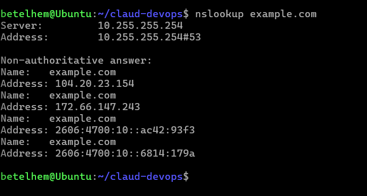
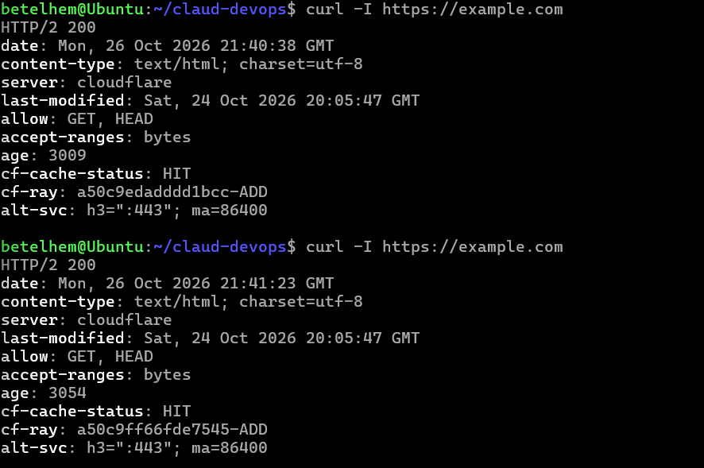

# Week 2 Networking & IAM Lab

**Name:** Betelhem Sefiw
**Date Completed:** October 27, 2026

## Task 1 — Identify Your Network Information
- **Operating System:** Ubuntu Linux (WSL)
- **Local IPv4 Address:** 172.25.11.55
- **Default Gateway/Router Address:** 172.25.0.1
- **Private or Public?** Private

## Task 2 — Practice Subnetting
Starting network: `10.0.0.0/24`. 
To divide into 4 equal subnets, we borrow 2 bits, changing the prefix to **/26**. 
Each /26 subnet has \(2^6 = 64\) total addresses. 
*Standard AWS subnet rules reserve 5 IP addresses per subnet, leaving 59 usable addresses.*

| Subnet | CIDR | Network Address | Full Address Range | Usable Host Range | Broadcast Address | Usable IPs (AWS) |
| :--- | :--- | :--- | :--- | :--- | :--- | :--- |
| 1 | /26 | 10.0.0.0 | 10.0.0.0 - 10.0.0.63 | 10.0.0.1 - 10.0.0.62 | 10.0.0.63 | 59 |
| 2 | /26 | 10.0.0.64 | 10.0.0.64 - 10.0.0.127 | 10.0.0.65 - 10.0.0.126 | 10.0.0.127 | 59 |
| 3 | /26 | 10.0.0.128 | 10.0.0.128 - 10.0.0.191 | 10.0.0.129 - 10.0.0.190 | 10.0.0.191 | 59 |
| 4 | /26 | 10.0.0.192 | 10.0.0.192 - 10.0.0.255 | 10.0.0.193 - 10.0.0.254 | 10.0.0.255 | 59 |

## Task 3 — Test DNS Resolution
- **Domain tested:** `example.com`
- **Succeeded?** Yes
- **IP Addresses returned:** `172.66.147.243`, `104.20.23.154`, `2606:4700:10::ac42:93f3`, `2606:4700:10::6814:179a`
- **What DNS does:** DNS translates human-readable domain names into machine-readable IP addresses so browsers can find the correct web server.

## Task 4 — Inspect an HTTPS Website
- **Website loaded successfully?** Yes
- **HTTP Status Code:** `HTTP/2 200`
- **What HTTPS adds to HTTP:** HTTPS adds encryption via TLS, ensuring data is secure, private, and unaltered during transit, and verifies the server's identity.
- **Why DNS alone doesn't guarantee a load:** DNS only finds the server's IP address. The connection can still fail due to a downed server, a blocked firewall, an expired TLS certificate, or an HTTP error.

## Task 5 — Interpret HTTP Status Codes

| Status code | Meaning | Example situation |
| :--- | :--- | :--- |
| 200 | OK | A webpage loads successfully. |
| 301 | Moved Permanently | An old URL redirects to a new domain. |
| 403 | Forbidden | Trying to access a file you don't have permission for. |
| 404 | Not Found | Typing a URL for a page that doesn't exist. |
| 500 | Internal Server Error | A bug in the server's code crashed the webpage. |

**Differences in Failures:**
- **DNS failure:** The domain name cannot be translated into an IP address (the phonebook is missing the name).
- **Connection timeout:** The IP was found, but the server is not responding (the phone rings but nobody answers).
- **TLS certificate error:** You connected, but the security certificate is invalid or expired (the ID card doesn't match).
- **HTTP error response:** The server successfully received the request but is returning an error code (e.g., 404 or 500) instead of the webpage.

## Task 6 — Write a Least-Privilege IAM Policy

- **Which field specifies the permitted action?** The `"Action"` field.
- **Which field specifies the resources?** The `"Resource"` field.
- **Does s3:GetObject allow listing all objects?** No, `s3:GetObject` only allows downloading/reading a specific object. To list objects, you need `s3:ListBucket`.
- **Why is a narrow permission safer than s3:*?** It follows the Principle of Least Privilege, limiting the "blast radius" if credentials are compromised. A user only gets exactly what they need to do their job.
- **Why should AWS access keys never be committed to GitHub?** Hackers actively scan public GitHub repositories for exposed keys, which can lead to massive data breaches and high financial costs.

## Task 7 — Troubleshooting Practice

1.  **Domain does not resolve:** Investigate **DNS**. (Check if the domain is misspelled or if the DNS server is down).
2.  **Domain resolves, but connection times out:** Investigate **Network Connectivity**. (The IP was found, but a firewall is blocking traffic or the server is offline).
3.  **TLS certificate warning:** Investigate **TLS**. (The server is reachable, but the certificate is expired, self-signed, or the domain name doesn't match).
4.  **HTTP 404:** Investigate **HTTP/Application**. (The network is perfect, but the specific file/page requested does not exist on the server).
5.  **EC2 reaches S3 but gets AccessDenied:** Investigate **IAM/S3 Authorization**. (The network works, but the EC2 instance's IAM Role lacks the correct S3 policy).
