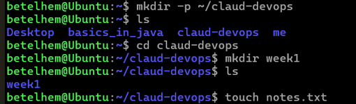
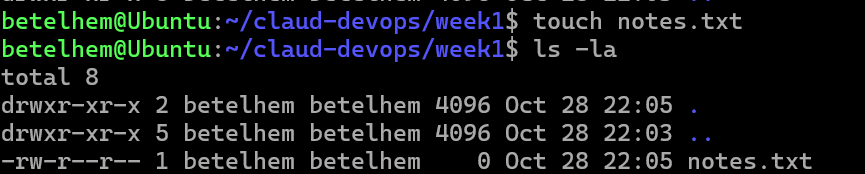
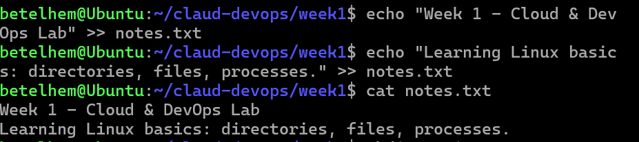
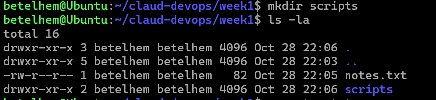
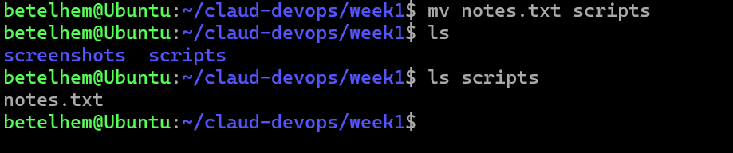
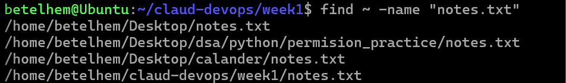
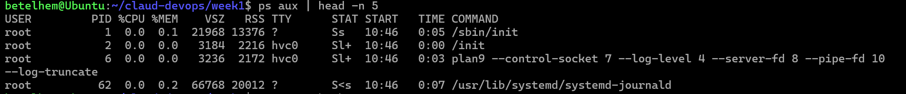

# Cloud & DevOps — Hands-on Labs

This repository contains my Cloud & DevOps track labs.

---

## Week 1 — Linux Basics

**Location:** [`week1/`](week1/)

### Tasks Completed

| # | Task | Command Used |
|---|------|--------------|
| 1 | Create workspace directory | `mkdir -p ~/claud-devops/week1` |
| 2 | Create `notes.txt` | `touch notes.txt` |
| 3 | Add text to `notes.txt` | `echo "Week 1 - Cloud & DevOps Lab" >> notes.txt` |
| 4 | Create `scripts/` directory | `mkdir scripts` |
| 5 | Move `notes.txt` into `scripts/` | `mv notes.txt scripts/` |
| 6 | Search for `notes.txt` | `find ~ -name "notes.txt" 2>/dev/null` |
| 7 | Find a running process and its PID | `ps aux \| head -n 5` |

### 📸 Screenshots Evidence

#### 1. Workspace Directory Created


#### 2. notes.txt Created


#### 3. Text Added to notes.txt


#### 4. scripts/ Directory Created


#### 5. notes.txt Moved into scripts/


#### 6. notes.txt Found with `find`


#### 7. Running Process and PID


### Key Commands Summary

```bash
mkdir -p ~/claud-devops/week1     # create directory tree
cd ~/claud-devops/week1           # enter directory
touch notes.txt                   # create empty file
echo "text" >> notes.txt          # append text
cat notes.txt                     # view contents
mkdir scripts                     # create folder
mv notes.txt scripts/             # move file
find ~ -name "notes.txt" 2>/dev/null   # search file
ps aux | head -n 5                # list processes + PIDs
pgrep -a bash                     # find PIDs by name
```

---

## Author

Betelhem Sefiw — Cloud & DevOps Track
